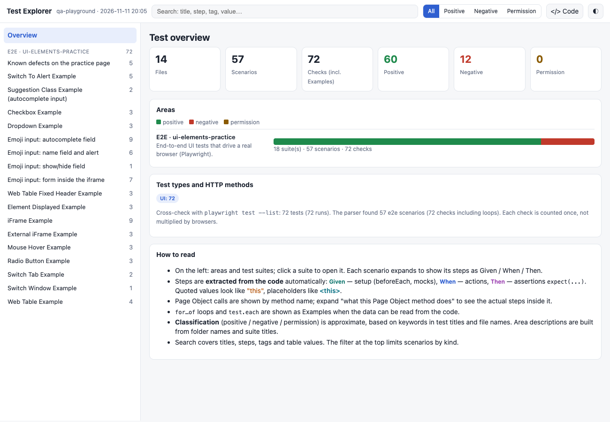
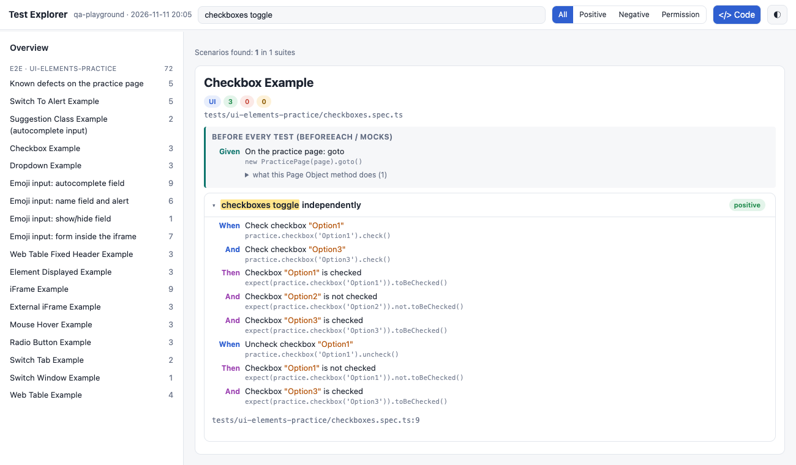
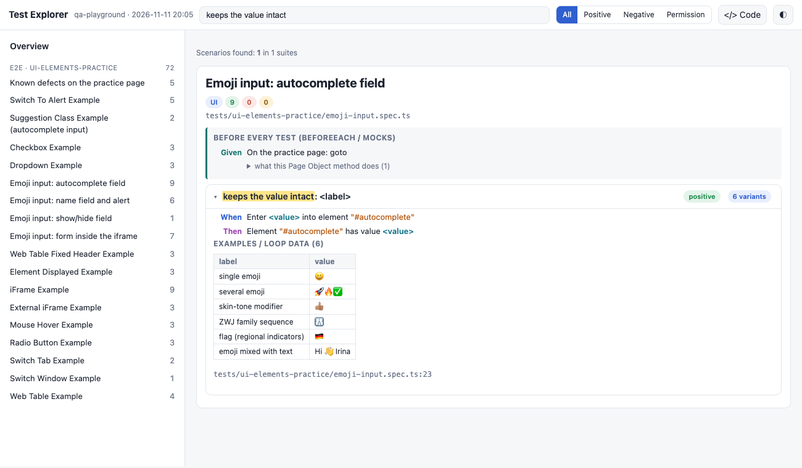
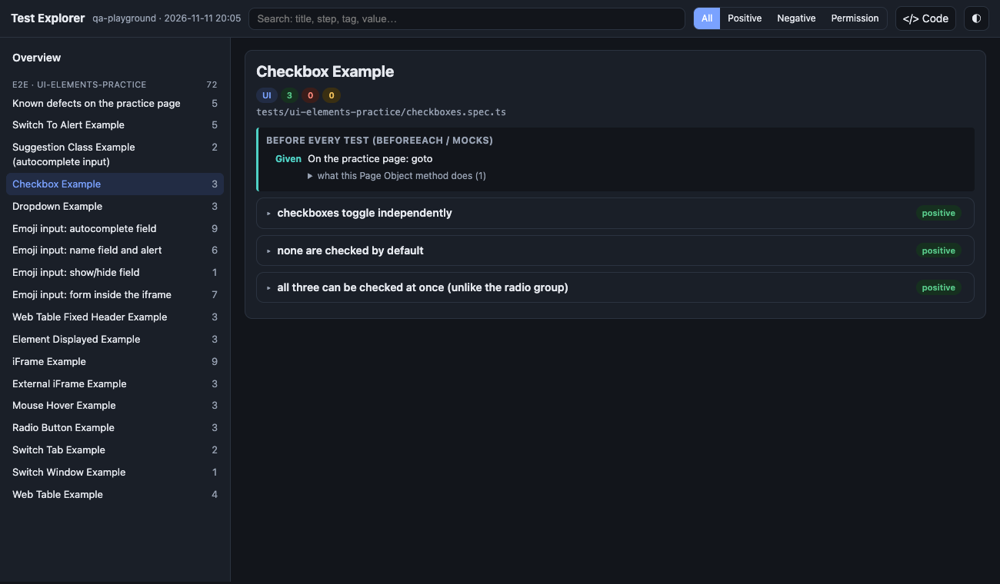

# Test Explorer prompt

A prompt for an LLM coding agent (Claude Code, Cursor, Copilot Agent, etc.) that turns a project's automated tests into a **single self-contained `index.html`** showing, in plain English, *what the tests actually verify*: which areas are covered, which scenarios exist, with what data and expected results.

The audience is people who don't read test code: managers, analysts, new QA engineers.

## How to use

1. Open your project in an agent that can read and run files in the repo.
2. Paste the contents of [`prompt.md`](prompt.md) (everything below its horizontal rule) into the agent, or tell it to follow the file.
3. The agent will:
   - inspect the stack and test layout,
   - write a parser that extracts tests into JSON,
   - translate every code step into a plain-English sentence (see below),
   - build the web app and embed the data,
   - verify counts and the page in headless Chrome.
4. Open `test-explorer/index.html` (double-click, no server needed). To refresh after tests change: `node test-explorer/build.mjs`.

If the agent has no file access, attach the test folder structure and a few sample test files.

## Preview

Generated from a Playwright test suite for a public QA practice page (14 files, 57 scenarios, 72 checks).

**Overview**: counters, per-area bars, cross-check with the framework's own list command.

**Plain-English steps** with the original code revealed by the "Show code" toggle:

**Parametrized tests** expand into Examples tables, and search highlights matches:

**Dark theme** (also follows the system setting):

## What you get

A new `test-explorer/` folder in your project containing `build.mjs`, `template.html` and `index.html`. Existing project files are not modified and nothing is committed.

The page includes:

- **Overview**: counters (files, scenarios, checks), a per-area bar chart split into positive / negative / permission, HTTP-method summary, a "How to read" block
- **Left tree** of areas and suites with counters
- **Suite cards** with badges, file path, tags and "before every test" setup
- **Collapsible scenarios** with colored Given / When / Then steps written in plain English, highlighted `"values"` and `<placeholders>`, full Examples and data tables
- **"Show code" toggle** that reveals the original source line under every step, so readers can verify the translation
- **Search** across names, steps, tags and Examples values, with highlighting
- **Filters** by kind (all / positive / negative / permission)
- Light and dark themes, responsive layout, **no CDN or external libraries**, fully offline
- All UI text in **English**; test titles are shown exactly as written in the source

## Code to plain English

Non-Gherkin tests are code, so the prompt (Step 2b) makes the agent translate each step from the AST into a sentence a non-programmer can read. Translation is rule-based and never guessed:

| Test code | Shown as |
|---|---|
| `expect(page.getByRole("heading", { name: "My Profile" })).toBeVisible()` | **"My Profile" heading is visible** |
| `practice.checkbox("Option1").check()` | **Check checkbox "Option1"** |
| `expect(page.getByText(message)).not.toBeVisible()` | **Text `<message>` is not visible** |
| `page.goto("/user/profile")` | **Open "/user/profile"** |
| `jest.mock("@/utils/form")` | **Mock module "@/utils/form"** |
| `expect(result).toEqual("In office")` | **result equals "In office"** |

Locators that live in Page Objects are resolved to what they really select, Page Object methods get an expandable "what this method does" list, and anything the rules don't cover falls back to `Call <name> with <args>` with the raw code kept visible.

## Supported test frameworks

| Framework | Approach |
|---|---|
| Gherkin / Cucumber | direct parser for `.feature` files |
| Playwright | `playwright test --list` for the test list, AST/source for steps and assertions |
| Jest / Mocha / Vitest | AST of `describe` / `it` / `test`, `each` tables expanded |
| pytest | `ast` module, `parametrize` read into Examples |
| Cypress, Selenium, JUnit/TestNG | adaptation rules in the prompt |

The prompt requires the agent to cross-check its test count against the framework's own listing command and to never invent descriptions of what a test checks.

## Notes and limitations

- Classification into positive / negative / permission is **heuristic**, based on keywords in test titles; the agent is told to re-derive the keywords from each project and to say so in the UI.
- Area descriptions are built from folder names and suite titles, not invented.
- Page Object calls are shown by (humanized) method name; the agent should resolve what they do rather than guess.
- Results depend on the agent used; always check the reported counts against the framework's list command.

## Origin

Developed and tried on Next.js projects with Playwright e2e and Jest unit tests. Other frameworks are covered by the adaptation section of the prompt but have not all been tested.
